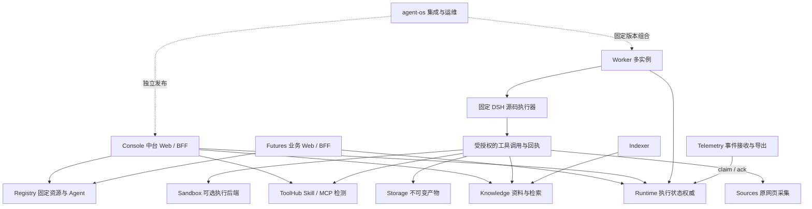

# 项目群架构与存储边界

这是维护定位图。每条调用的认证、路由、字段与版本仍以 Owner 代码和固定契约为准；图不表示所有可选后端已安装。

逻辑服务/数据归属可跨平台使用。下文端口、安装和生产默认描述均来自原 Windows；Mac 接手者不得据此认定服务已启动或凭证可用，需按 [环境映射](environments.json) 建立自己的独立配置和观测。

## 服务、源码与数据权威

| 服务（本机端口） | Owner 仓库 | 数据所有权与职责 |
| --- | --- | --- |
| Console/control (8090) | agent-os-console | 中台 Web/BFF，无数据库直连 |
| Futures (8098) | agent-os-futures | 独立业务 Web/BFF、报告检查 MCP，无数据库直连 |
| Registry (8096) | agent-os-registry | registry 域：Agent/提示词/知识库等固定资源定义、绑定版本及受保护凭证 |
| Runtime (8094) | agent-os-runtime | execution 域：运行、租约/fence、意图/回执、状态、笔记、事件 |
| Worker (8099) | agent-os-worker | 固定 execution 协议参与执行域；进程多实例，启动固定 DSH，不另建状态权威 |
| ToolHub (8091) | agent-os-toolhub | toolhub 域：Skill/MCP 版本、校验、验活、漂移、启停审计 |
| Knowledge (8095) | agent-os-knowledge | knowledge 域：文档、正文、块、来源归档、检索与索引任务 |
| Indexer (8097) | agent-os-indexer | 固定 indexing 协议参与 knowledge 域；后台索引，不拥有其他服务 DDL |
| Storage (8092) | agent-os-storage | storage 域：不可变产物和引用，不读取 Runtime 表 |
| Sources (8101) | agent-os-sources | sources 域：允许来源的公开 HTTPS 采集、原响应及文本留存 |
| Sandbox (8093) | agent-os-sandbox | sandbox 域：作业；通过 HTTP 校验 Runtime 权威，当前 Windows 执行后端未配 |
| Telemetry (8100) | agent-os-telemetry | telemetry 域：inbox/导出；消费带租约/fence 的 Runtime outbox，不直读执行库 |

`agent-os-sdk` 是固定公共协议/传输库；`agent-os-harness` 是固定官方 DSH 源码与适配；`agent-os` 管版本组合、发布、恢复、业务包和整体验收。主仓历史代码尚有待转移的测试覆盖，不能直接全删。

八个逻辑数据域不等于本机现在八台数据库：现有 Windows 使用原 PostgreSQL 的逻辑隔离/schema/账号，另有独立库测试。各 Owner 承担迁移；Runtime/Worker 与 Knowledge/Indexer 保留必要的窄原子事务协议，不能为了拆分而破坏一致性。新部署能力、当前权限及旧权限退役分别验收。

## 一次任务的权威链

1. Registry 固定 Agent、提示词、Skill、MCP、知识库绑定；ToolHub 的登记不自动授予执行授权。
2. Runtime 创建不可变运行快照，登记模型/工具调用意图，管理领取、租约、fence、预算与回执。
3. Worker 加载快照指定的 Harness 包。官方 DSH 决定模型/工具循环及 Compact，适配层把状态和结果交回持久化边界。
4. 工具按权限通过服务接口工作；执行效果不确定时先核对，不能因回执缺失就重复正式写入。
5. 业务只读自己的任务和明确投影的结果。Futures 的草稿投影由部署配置限定 app、工具、输入输出路径及版本，不开放通用回执管理接口。

Worker 固定 Runtime execution 包、Indexer 固定 Knowledge indexing 包，见 [仓库版本](repositories.json) 和 [集成清单](../../deploy/service-sources.json)。源码 HEAD、编译依赖和已安装二进制必须分别记录。

## 哪些在模型上下文，哪些必须落盘

| 对象 | 权威与生命周期 |
| --- | --- |
| 当前模型上下文 | 临时工作投影；可重建。Compact 不能成为证据的唯一副本 |
| 目标、约束、问题、证据索引、未决项 | 结构化版本化工作状态，写入 Runtime；后续动作依赖的变化应在动作前持久化 |
| 模型/工具调用意图与回执 | Runtime 冻结记录，包含重放所需参数/版本；有外部效果的未知结果先核对 |
| 原文、长输出、附件 | Sources/Knowledge/Storage 的不可变资料与引用；完整落盘后再确认，模型按需分页读取 |
| Compact 摘要 | 带输入/版本的派生材料，不能替代原文、约束和调用记录；按冻结协议重放 |
| Agent 笔记/长期记忆 | Runtime 中带来源、版本、有效/撤回状态；撤回不等于抹掉审计历史 |
| Node 驻留事件与可重建缓存 | 只在持久化确认及消费者水位允许后释放；失败退出与容量边界仍需按待办补测 |
| 发布包、配置、备份 | 运维权威状态，不是模型缓存；凭证受保护且不进入模型上下文 |

这是现有实现边界及维护约束，不表示生命周期所有场景均已验证。自动 GC 不得删除永久资料、未决恢复回执或仍被引用的内容；已有回收策略也须核对引用、年龄和故障证据，不能扩大成统一 TTL。

## DSH 与兼容

官方源码基线 `639ed015397290b3745d163aafe02ffee4aa3f84` 已纳管到 Harness 仓。`dsh-source-639ed015-state-v1`、resident-v2、budget-v3、native-v4 等历史引擎固定行为。当前默认支持 native-v4，但只对全原生能力 Agent 树使用它；全 legacy Agent 树仍回落固定 budget-v3，混合树拒绝，子任务继承父引擎。参见 Runtime `internal/runstate/store.go`。准确完整引擎标识以实际 manifest/快照为准；不能因为部署默认变更，就说旧 Agent 也获得原生长度能力，或删除仍需用到的 budget 包。

完整冻结回放已有约 99 次模型调用的联合测量；这是样本，不是任意长度承诺。当前不以另写 Session 快速快照作为前置条件。需要改 Session/Loop 核心时，先证明现有扩展点不足，保持官方来源、可复现构建和兼容证据。参考 [DSH 与存储决策](../architecture/dsh-source-and-storage-decision.md)、[联合验收](../resident-joint-acceptance-20261013.md)。

## 范围与非目标

本机 PostgreSQL 词法检索可完成基础链路。Milvus/LightRAG/Embedding、Sandbox 执行、Langfuse 的适配实现、历史测试和当前实际配置要分开；未配置不得显示已可用。项目群知识库不是业务事实库，也不替代生产数据库。服务器 HA、百万文档千万分块和全品种资料覆盖保留后续目标，见 [完整目标](objective.md)。

## Mac 开发观测增量（2026-10-15）

[独立 Mac 新记录](macos-research-and-storage-20261015.md)记录本机服务组合、代码候选及验证条件。数据所有权、固定 DSH 决策循环、历史协议和集成 pins 均未改变。Console 新增的可选 `FUTURES_PUBLIC_URL` 仅是用户浏览器的明确导航地址；它不同于服务内网地址，不转发中台身份，也不表示目标已部署。

本 Mac 后续已按两个指定提交安装匹配的 BFF/Web 包，见[完整包与第三次研究记录](macos-package-enospc-and-answer-contract-20261015.md)。鉴权就绪与公开入口配置核对不等于浏览器验收；该新观测不修改上文 Windows 端口历史、服务数据权威或集成 pins。独立 [Storage ENOSPC](../storage-enospc-macos-20261015.md)只验证新有界卷上的 artifact/reference 事务和同库恢复，没有引入 Runtime 或其他数据域的跨库写入。

本轮 [Runtime Owner ENOSPC](macos-runtime-enospc-20261015.md)仅在新隔离 PostgreSQL 上通过现有 Runtime Store、execution 协议及 Owner 迁移测试事务边界，结果为：1 项真实故障测试通过（1.21 秒，非 race，零 skip）。NOLOGIN/SET ROLE 不能替代独立账号登录；内存 archive 与合成 native 回执不能替代真实 Storage/Worker/DSH。无生产逻辑、旧快照、原协议、数据所有权或部署组合变化，也不新增决策循环。

[第四次同题研究及 UI 记录](macos-research-verification-and-ui-20261015.md)保留既有服务数据权威、固定 DSH/native 协议与部署 pins。供应商 503 无稿只构成该次执行失败，不证明成稿方法或业务质量；新观测不覆盖原 Windows 或旧 Mac 证据。
